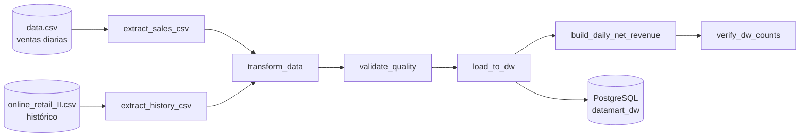
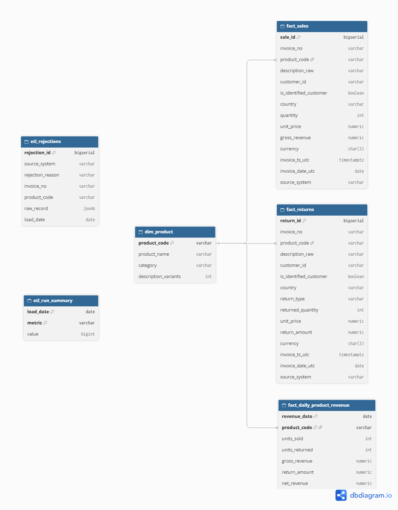

<div align="center">

# DataMart S.A.S.
 
**Pipeline ETL diario con Apache Airflow y Data Warehouse en PostgreSQL.**<br>
Dos fuentes de ventas en CSV → limpieza y reglas de negocio → validación de calidad → repositorio analítico listo para responder preguntas de negocio.
 


 
</div>

---
 
> [!IMPORTANT]
> **Todo corre en local con un solo comando:** `docker compose up -d`.
> Al levantar el entorno quedan creados el usuario admin, las Airflow Connections, las Airflow Variables y las tablas del repositorio analítico, sin pasos manuales. Ningún usuario ni contraseña aparece en el código: todo viene del `.env`.
 
## Lo que demuestra este proyecto
 
- Orquestación con **Airflow dentro de Docker**: 7 tareas con dependencias explícitas, schedule diario y reintentos automáticos.
- **Dos fuentes heterogéneas unificadas**: columnas con nombres distintos y formatos de fecha distintos llevados a un esquema estándar.
- **Reglas de negocio aplicadas**: ventas y devoluciones separadas, precios inválidos rechazados, fechas en UTC y códigos de producto normalizados.
- **Revenue bruto y neto** por producto y por día.
- **Validación de calidad antes de cargar**: si un chequeo falla, el repositorio analítico no se toca.
- **Log de rechazos** con el motivo, la fuente y el registro original.
- **Idempotencia real**: correr el DAG dos veces deja exactamente los mismos datos y los mismos IDs.
- **Consultas SQL** que responden las 7 preguntas de negocio y una recomendación respaldada por números.

## Resultados verificables
 
| Componente | Resultado |
|---|---:|
| Filas leídas de `data.csv` (ventas diarias) | 541.909 |
| Filas leídas del histórico | 536.350 |
| Ventas válidas (`fact_sales`) | **1.045.104** |
| Devoluciones y ajustes (`fact_returns`) | **17.216** |
| Registros rechazados (`etl_rejections`) | 15.939 (1,5 %) |
| Productos únicos (`dim_product`) | 3.806 |
| Tareas del DAG | 7/7 `success` |
| Duración de una corrida | ≈ 1 minuto |
| Idempotencia (dos corridas seguidas) | Mismos conteos, mismo revenue neto y mismos IDs |
 
Cuadre de filas: ningún registro se pierde, cada uno termina en ventas, devoluciones o el log de rechazos.
 
```text
1.078.259 leídas = 1.045.104 ventas + 17.216 devoluciones + 15.939 rechazadas
```
 
> [!NOTE]
> El detalle de cada cifra, los casos ambiguos y la recomendación al equipo de producto están en [`docs/DECISIONES.md`](docs/DECISIONES.md).
 
## Arquitectura
 

 
| Servicio | Para qué |
|---|---|
| `postgres-airflow` | Base de metadatos interna de Airflow |
| `postgres-dw` | Repositorio analítico (destino del pipeline), puerto `5433` en tu máquina |
| `airflow-init` | Migra la base, crea el admin, las Connections y las Variables, y termina |
| `airflow-webserver` | Interfaz web en http://localhost:8080 |
| `airflow-scheduler` | Detecta y ejecuta el DAG |
 
**Modelo de datos:** estrella simple con una dimensión de productos, dos tablas de hechos separadas para ventas y devoluciones, un agregado diario con el revenue neto y dos tablas de auditoría del pipeline.
 
<div align="center">
  
  <br>
  <a href="https://dbdiagram.io/d/DataMart-S-A-S-6ae0b7dded134e407e1f525f">Ver el diagrama interactivo en dbdiagram.io</a>
</div>

## Puesta en marcha (≈ 10 minutos)
 
### Requisitos
 
- Docker Desktop (o Docker Engine + Compose v2) con **al menos 4 GB de RAM** asignados.
- Los dos CSV de Kaggle **ya vienen incluidos** en `data/raw/` (cada uno pesa menos de 50 MB).
<details>
<summary>¿Quieres descargar los CSV de nuevo?</summary>

- **Ventas diarias** → https://www.kaggle.com/datasets/carrie1/ecommerce-data — archivo `data.csv` (se deja con ese nombre).
- **Historial extendido** → https://www.kaggle.com/datasets/gabrielramos87/an-online-shop-business — archivo `Sales Transaction v.4a.csv`, que se **renombra a `online_retail_II.csv`**.
El dataset original del enunciado (thedevastator/online-retail-transaction-dataset) también funciona sin cambios.
 
</details>

### Pasos
 
```bash
# 1. Clonar
git clone https://github.com/AngelusML/DataMart-S.A.S.git
cd DataMart-S.A.S
 
# 2. Variables de entorno
cp .env.example .env          # en Windows PowerShell: copy .env.example .env
 
# 3. Los CSV ya están en data/raw/ (data.csv y online_retail_II.csv)
 
# 4. Levantar todo
docker compose up -d
```
 
`airflow-init` crea el usuario admin, las **Connections** y las **Variables**, y termina (estado `Exited (0)` es lo correcto). Después arrancan webserver y scheduler.
 
```bash
docker compose ps -a     # postgres-airflow, postgres-dw y webserver "healthy", scheduler "Up", airflow-init "Exited (0)"
```
 
Abrir **http://localhost:8080** → usuario/contraseña = `AIRFLOW_ADMIN_USER` / `AIRFLOW_ADMIN_PASSWORD` del `.env`.
 
## Verificar Connections y Variables
 
```bash
docker compose exec airflow-scheduler airflow connections list
docker compose exec airflow-scheduler airflow variables list
docker compose exec airflow-scheduler airflow dags list-runs -d datamart_etl_pipeline
```
 
O en la UI: **Admin → Connections** (`dw_postgres`, `fs_datamart_raw`) y **Admin → Variables**.
 
| Tipo | Nombre | Para qué |
|---|---|---|
| Connection | `dw_postgres` | Repositorio analítico destino |
| Connection | `fs_datamart_raw` | Carpeta donde están los CSV (`extra.path`) |
| Variable | `datamart_sales_file` | Nombre del CSV diario |
| Variable | `datamart_history_file` | Nombre del CSV histórico |
| Variable | `datamart_source_timezone` | Zona horaria de las fuentes (`Europe/London`) |
| Variable | `datamart_max_reject_pct` | % máximo de rechazos antes de detener la carga |
| Variable | `datamart_staging_dir` | Carpeta temporal entre tareas |
 
## Ejecutar el pipeline
 
El DAG `datamart_etl_pipeline` está activo y corre una vez al levantar el entorno. Para lanzarlo a mano:
 
```bash
docker compose exec airflow-scheduler airflow dags trigger datamart_etl_pipeline
```
 
O en la UI, botón ▶ (*Trigger DAG*). Cada corrida tarda alrededor de 1 minuto con los archivos completos.
 
## Verificar que los datos llegaron
 
Usuario y base son los de `DW_USER` y `DW_DB` en el `.env` (por defecto `datamart` y `datamart_dw`):
 
```bash
docker compose exec postgres-dw psql -U datamart -d datamart_dw -c "SELECT metric, value FROM etl_run_summary ORDER BY metric;"
```
 
Correr todas las consultas de negocio:
 
```bash
# Linux / macOS / Git Bash
docker compose exec -T postgres-dw psql -U datamart -d datamart_dw < sql/queries/business_questions.sql
```
 
```powershell
# Windows PowerShell
Get-Content sql/queries/business_questions.sql | docker compose exec -T postgres-dw psql -U datamart -d datamart_dw
```
 
> [!TIP]
> También se puede abrir con **DBeaver** o pgAdmin: host `localhost`, puerto `5433`, y base, usuario y contraseña los de `DW_*` en el `.env`.
 
## Exploración de las fuentes
 
```bash
# Linux / macOS / Git Bash
docker compose exec airflow-scheduler python /opt/airflow/scripts/explore_sources.py > docs/exploracion.md
```
 
```powershell
# Windows PowerShell (la primera línea evita tildes rotas)
[Console]::OutputEncoding = [System.Text.Encoding]::UTF8
docker compose exec airflow-scheduler python /opt/airflow/scripts/explore_sources.py | Out-File -Encoding utf8 docs/exploracion.md
```
 
## Reiniciar desde cero
 
```bash
docker compose down -v      # borra contenedores y volúmenes (las tablas se recrean al subir)
docker compose up -d
```
 
## Documentación
 
| Documento | Contenido |
|---|---|
| [`docs/DECISIONES.md`](docs/DECISIONES.md) | Modelo, casos ambiguos, idempotencia, resultados y recomendación |
| [`docs/diccionario_datos.md`](docs/diccionario_datos.md) | Diccionario de datos: tablas, columnas, llaves y reglas |
| [`docs/exploracion.md`](docs/exploracion.md) | Exploración de las fuentes y hallazgos |
| [`docs/modelo_datos.png`](docs/modelo_datos.png) | Diagrama del modelo de datos |
| [`docs/modelo_datos.dbml`](docs/modelo_datos.dbml) | Fuente del diagrama (pegar en dbdiagram.io) |
| [Diagrama interactivo](https://dbdiagram.io/d/DataMart-S-A-S-6ae0b7dded134e407e1f525f) | El mismo diagrama en dbdiagram.io |
| [`sql/queries/business_questions.sql`](sql/queries/business_questions.sql) | Consultas de la sección 7 y de validación |
 
## Estructura del repositorio
 
<details>
<summary>Ver el árbol completo</summary>

```text
DataMart-S.A.S/
├── docker-compose.yml               # 5 servicios: 2 Postgres, init, webserver, scheduler
├── .env.example                     # variables de entorno (copiar a .env)
├── .gitignore / .gitattributes
├── config/
│   └── airflow_variables.json       # Airflow Variables que se importan al iniciar
├── dags/
│   ├── .airflowignore               # Airflow no busca DAGs dentro de etl/
│   ├── datamart_etl_dag.py          # el DAG (solo orquesta las 7 tareas)
│   └── etl/
│       ├── config.py                # constantes, alias de columnas, formatos de fecha
│       ├── extract.py               # lectura de los CSV
│       ├── transform.py             # limpieza y reglas de negocio
│       ├── quality.py               # validaciones antes de cargar
│       └── load.py                  # carga a PostgreSQL y revenue neto diario
├── sql/
│   ├── ddl/01_create_tables.sql     # se ejecuta solo al iniciar postgres-dw
│   └── queries/business_questions.sql  # consultas de la sección 7 + validación
├── data/
│   ├── raw/
│   │   ├── data.csv                 # ventas diarias (carrie1)
│   │   └── online_retail_II.csv     # histórico (gabrielramos87, renombrado)
│   └── seeds/category_keywords.csv  # reglas para asignar categoría
├── scripts/
│   └── explore_sources.py           # reporte de exploración de las fuentes
└── docs/
    ├── DECISIONES.md                # decisiones técnicas, resultados y recomendación
    ├── diccionario_datos.md         # diccionario de datos
    ├── exploracion.md               # exploración de las fuentes y hallazgos
    ├── modelo_datos.png             # diagrama del modelo
    └── modelo_datos.dbml            # fuente del diagrama (dbdiagram.io)
```
 
</details>

## Problemas comunes
 
| Síntoma | Solución |
|---|---|
| `extract_*` falla con *No se encontró el archivo* | Revisar nombres en `data/raw/` y relanzar el DAG |
| El webserver no abre | Esperar 1–2 min; ver `docker compose logs airflow-webserver` |
| Tareas mueren sin error (SIGKILL) | Subir la RAM de Docker a 4–6 GB |
| Cambié el DDL y no se aplica | `docker compose down -v` (el DDL solo corre con volumen vacío) |
| `docker pull` falla con *TLS handshake timeout* | Docker Desktop → Settings → Resources → Proxies → *No proxy* |
| No descarga `apache/airflow:2.10.5` desde Docker Hub | `docker pull mirror.gcr.io/apache/airflow:2.10.5` y luego `docker tag mirror.gcr.io/apache/airflow:2.10.5 apache/airflow:2.10.5` |
| En la UI de Airflow no aparece el DAG | Quitar el filtro *Running*: botón **All** |
| `docs/exploracion.md` sale con símbolos raros en Windows | Ejecutar antes `[Console]::OutputEncoding = [System.Text.Encoding]::UTF8` |